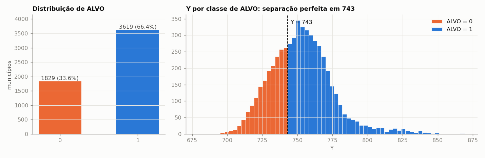
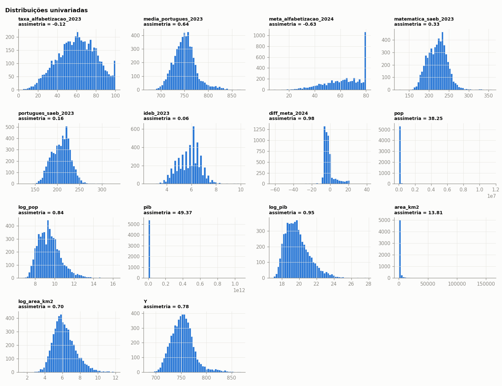
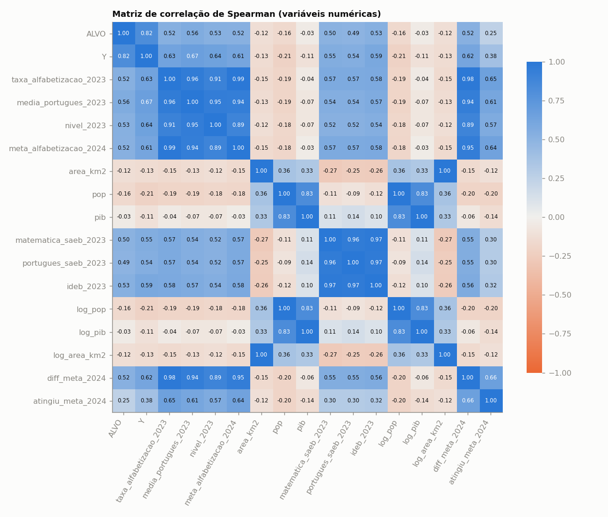
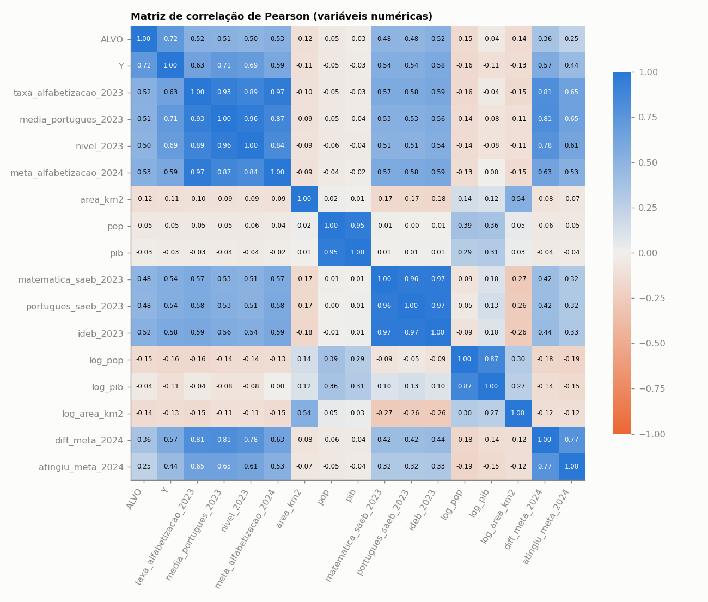
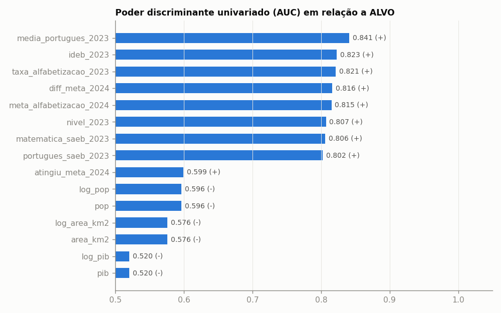
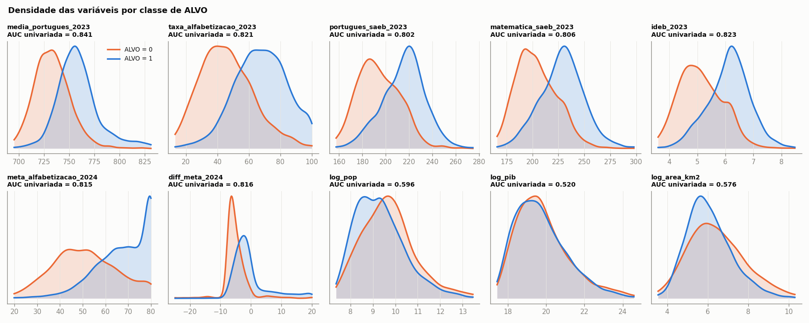
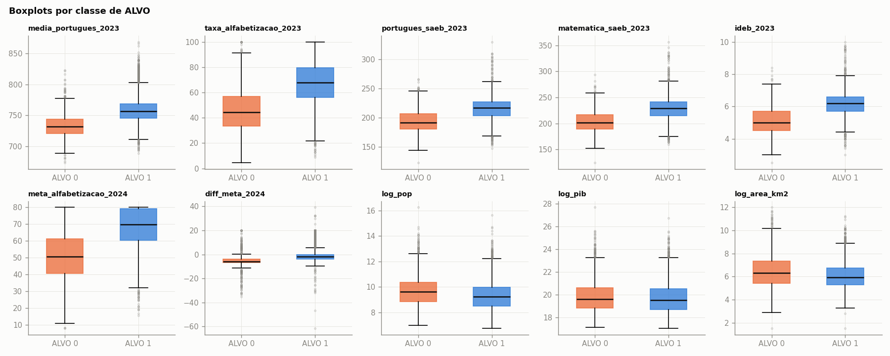
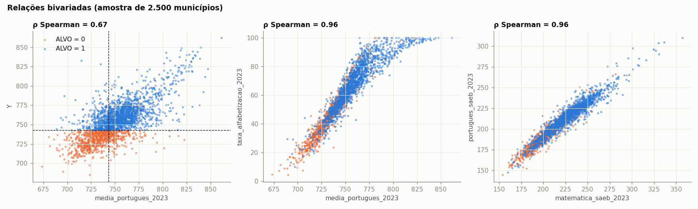
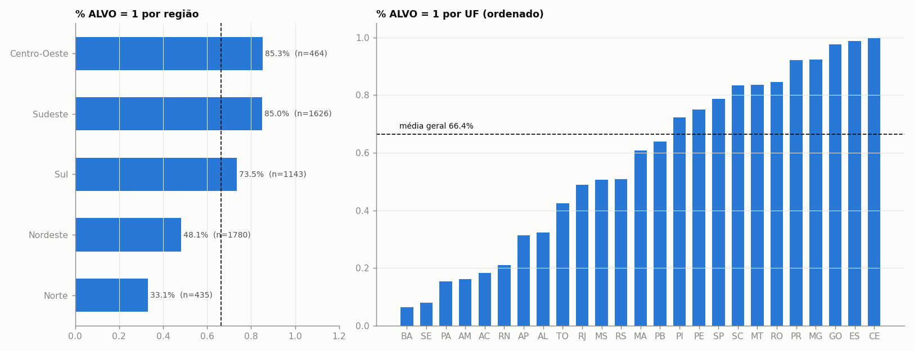
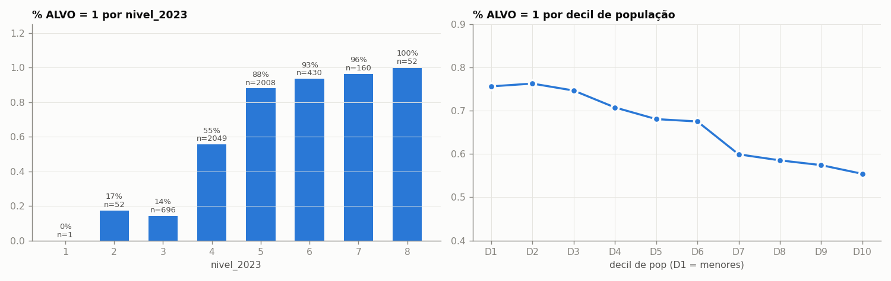

# Análise Exploratória:

**Objetivo:** entender a base antes de ajustar um modelo supervisionado com a variável resposta **`ALVO`** (binária).
---
da
## Resumo

1. **`Y` vaza o alvo e precisa sair do modelo.** `ALVO = 1` se e somente se `Y ≥ 743` (100% de concordância). 743 é o ponto de corte da escala de alfabetização do Saeb/Compromisso Criança Alfabetizada. Logo, `Y` parece ser a proficiência média de 2024 e `ALVO` indica se o município atingiu o patamar de "alfabetizado".
2. **A base está limpa.** São 5.448 municípios × 22 colunas, sem valores ausentes e sem linhas ou IDs duplicados. Faltam DF e RR.
3. **O alvo está moderadamente desbalanceado:** 66,4% de 1 e 33,6% de 0.
4. **O melhor preditor isolado é `media_portugues_2023`** (AUC 0,84), a mesma métrica de `Y` medida um ano antes. Só a regra "`media_portugues_2023 ≥ 743`" já acerta **78,0%** dos casos, contra 66,4% de quem chuta sempre a classe majoritária.
5. **A localização pesa muito.** UF tem V de Cramér de 0,62. O % de `ALVO = 1` varia de 6% (BA) a 100% (CE).
6. **Há multicolinearidade forte e variáveis derivadas.** `diff_meta_2024 = taxa_alfabetizacao_2023 − meta_alfabetizacao_2024` de forma exata, e `atingiu_meta_2024 = 1{diff_meta_2024 ≥ 0}`. As colunas `log_*` são `log1p` das originais. O grupo Saeb/Ideb tem ρ ≥ 0,96 entre si.
7. **As variáveis socioeconômicas discriminam pouco.** População e área têm relação negativa fraca com o alvo (AUC ≈ 0,58–0,60). O PIB total quase não discrimina (AUC 0,52), mas o PIB per capita ajuda um pouco (AUC 0,61).

---

## 1. Estrutura da base

| Item | Valor |
|---|---|
| Linhas (municípios) | 5.448 |
| Colunas | 22 |
| Valores ausentes | 0 em todas as colunas |
| Linhas duplicadas / `id_municipio` duplicado | 0 / 0 |
| Nomes de município repetidos | 263 (homônimos em UFs diferentes; use `id_municipio` como chave) |
| UFs presentes | 25 (ausentes: **DF** e **RR**) |
| Encoding | correto (UTF-8). Caracteres como `Adel ndia` são só um problema de exibição do terminal |

### Dicionário inferido

| Coluna | Tipo | Papel / observação |
|---|---|---|
| `id_municipio` | texto (7 díg., código IBGE) | identificador. **Não usar como feature** |
| `nome_municipio` | texto | identificador. **Não usar** |
| `Y` | float | proficiência contínua (provavelmente 2024). **Define o ALVO, então é vazamento** |
| `ALVO` | int (0/1) | **variável resposta** = `1{Y ≥ 743}` |
| `taxa_alfabetizacao_2023` | float (%) | % de alunos alfabetizados em 2023 |
| `media_portugues_2023` | float | proficiência média em 2023 (mesma escala de `Y`) |
| `nivel_2023` | int 1–8 | faixa de `media_portugues_2023` em intervalos de 25 pontos (≤700 → 2, 700–725 → 3, …, >825 → 8) |
| `meta_alfabetizacao_2024` | float (%) | meta do município para 2024, com teto de 80 |
| `meta_alfabetizacao_2030` | float | **constante (80) e sem informação: descartar** |
| `nome_regiao`, `sigla_uf` | categóricas | 5 regiões, 25 UFs |
| `area_km2`, `pop`, `pib` | numéricas | muito assimétricas |
| `log_pop`, `log_pib`, `log_area_km2` | float | `log1p` das anteriores |
| `matematica_saeb_2023`, `portugues_saeb_2023`, `ideb_2023` | float | resultados do Saeb/Ideb 2023 (outra escala) |
| `diff_meta_2024` | float | `taxa_alfabetizacao_2023 − meta_alfabetizacao_2024` (identidade exata) |
| `atingiu_meta_2024` | int (0/1) | `1{diff_meta_2024 ≥ 0}` (identidade exata) |

---

## 2. Variável resposta e vazamento

| ALVO | n | % | Y mín | Y máx | Y médio |
|---|---|---|---|---|---|
| 0 | 1.829 | 33,6% | 685,03 | **742,99** | 730,0 |
| 1 | 3.619 | 66,4% | **743,02** | 868,01 | 764,4 |

As classes não se sobrepõem em `Y`, então `ALVO` é uma dicotomização de `Y` no ponto 743. Isso traz três consequências:

- **`Y` não pode entrar como feature** (daria AUC = 1).
- `Y` pode ser útil como **alvo alternativo**: dá para fazer uma regressão de `Y` e depois classificar com o limiar 743, comparando com a classificação direta.
- Na comparação entre 2023 e o alvo, `media_portugues_2023 ≥ 743` e `ALVO` concordam em 78% dos municípios:

| | 2023 < 743 | 2023 ≥ 743 |
|---|---|---|
| **ALVO = 0** | 1.347 | 482 |
| **ALVO = 1** | 719 | 2.900 |

  Ou seja, 482 municípios estavam acima do corte em 2023 e caíram, e 719 estavam abaixo e subiram. O modelo precisa explicar essa **mudança entre anos**, porque é aí que está o ganho sobre a regra simples.

---

## 3. Estatísticas descritivas (numéricas)

| Variável | média | dp | mín | Q1 | mediana | Q3 | máx | assimetria |
|---|---|---|---|---|---|---|---|---|
| Y | 752,85 | 22,53 | 685,03 | 737,67 | 751,86 | 765,31 | 868,01 | 0,78 |
| taxa_alfabetizacao_2023 | 60,24 | 19,69 | 4,35 | 46,59 | 60,64 | 74,76 | 100,00 | −0,12 |
| media_portugues_2023 | 750,38 | 24,21 | 673,30 | 734,83 | 749,14 | 763,41 | 868,46 | 0,64 |
| nivel_2023 | 4,51 | 1,01 | 1 | 4 | 4 | 5 | 8 | 0,52 |
| meta_alfabetizacao_2024 | 62,16 | 14,97 | 7,94 | 52,32 | 64,18 | 75,30 | 80,00 | −0,63 |
| matematica_saeb_2023 | 220,53 | 24,63 | 124,27 | 202,70 | 221,64 | 236,46 | 356,85 | 0,33 |
| portugues_saeb_2023 | 208,46 | 21,68 | 122,86 | 192,72 | 210,13 | 223,06 | 329,95 | 0,16 |
| ideb_2023 | 5,80 | 0,93 | 2,5 | 5,1 | 5,9 | 6,4 | 10,0 | 0,06 |
| diff_meta_2024 | −1,93 | 6,48 | −61,62 | −5,52 | −3,21 | −0,76 | 39,19 | 0,98 |
| area_km2 | 1.507 | 5.581 | 3,6 | 205,5 | 420,6 | 1.026,8 | 159.533 | **13,8** |
| pop | 36.473 | 205.274 | 833 | 5.350 | 11.177 | 24.705 | 11.451.999 | **38,3** |
| pib (R$) | 1,93 bi | 16,9 bi | 25,3 mi | 137,8 mi | 313,6 mi | 853,4 mi | 1,07 tri | **49,4** |
| log_pop | 9,46 | 1,18 | 6,73 | 8,59 | 9,32 | 10,11 | 16,25 | 0,84 |
| log_pib | 19,79 | 1,41 | 17,05 | 18,74 | 19,56 | 20,57 | 27,70 | 0,95 |
| log_area_km2 | 6,21 | 1,27 | 1,52 | 5,33 | 6,04 | 6,94 | 11,98 | 0,70 |

**O que se vê nos histogramas:**
- `pop`, `pib` e `area_km2` têm caudas extremas (São Paulo, Rio etc.). Os `log_*` deixam as distribuições quase simétricas, então **prefira as versões log**.
- `meta_alfabetizacao_2024` tem um acúmulo no **teto de 80**. Parece uma meta calculada a partir da taxa de 2023 e limitada a 80.
- `taxa_alfabetizacao_2023` tem 59 municípios com 100%.
- `diff_meta_2024` é muito concentrada perto de −3 e tem caudas longas (curtose 6,2).

### Outliers (regra 1,5 × IIQ)

| Variável | nº outliers | Comentário |
|---|---|---|
| pib / area_km2 / pop | 721 / 647 / 596 | efeito da assimetria. Somem quase todos com o log (131 / 111 / 115) |
| diff_meta_2024 | 623 | caudas longas em torno de uma distribuição estreita |
| media_portugues_2023 / Y | 180 / 148 | sobretudo na cauda superior (> 800) |
| ideb_2023 / saeb | 37 / ~40 | **19 municípios com Ideb ≥ 9** (ex.: Ideb 10 no CE, 9,8 no AL, com Saeb de matemática > 330). São valores atípicos que valem uma checagem de plausibilidade |

---

## 4. Matriz de correlação (variáveis numéricas)

Pearson mede relação **linear** e Spearman mede relação **monotônica**, por postos. Spearman é mais robusto às caudas de `pop` e `pib`.

### Correlação com `ALVO`

| Variável | Pearson (ponto-bisserial) | Spearman |
|---|---|---|
| ~~Y~~ (vazamento) | 0,722 | 0,818 |
| media_portugues_2023 | 0,512 | **0,557** |
| nivel_2023 | 0,500 | 0,531 |
| ideb_2023 | 0,521 | 0,528 |
| taxa_alfabetizacao_2023 | 0,522 | 0,524 |
| meta_alfabetizacao_2024 | 0,530 | 0,516 |
| diff_meta_2024 | 0,362 | 0,516 |
| matematica_saeb_2023 | 0,485 | 0,500 |
| portugues_saeb_2023 | 0,480 | 0,494 |
| atingiu_meta_2024 | 0,246 | 0,246 |
| log_pop | −0,152 | −0,157 |
| log_area_km2 | −0,142 | −0,125 |
| log_pib | −0,039 | −0,033 |

Note que `diff_meta_2024` tem Pearson 0,36 mas Spearman 0,52. As caudas longas mascaram a relação linear, então **transformar ou usar modelos baseados em árvore** aproveita melhor essa variável.

### Pares fortemente correlacionados (|ρ Spearman| ≥ 0,7, sem os pares X × log X)

| Par | Pearson | Spearman |
|---|---|---|
| taxa_alfabetizacao_2023 × meta_alfabetizacao_2024 | 0,967 | 0,985 |
| taxa_alfabetizacao_2023 × diff_meta_2024 | 0,806 | 0,980 |
| matematica_saeb_2023 × ideb_2023 | 0,974 | 0,975 |
| portugues_saeb_2023 × ideb_2023 | 0,969 | 0,968 |
| taxa_alfabetizacao_2023 × media_portugues_2023 | 0,931 | 0,960 |
| matematica_saeb_2023 × portugues_saeb_2023 | 0,961 | 0,959 |
| media_portugues_2023 × nivel_2023 | 0,958 | 0,946 |
| media_portugues_2023 × meta_alfabetizacao_2024 | 0,872 | 0,945 |
| log_pop × log_pib | 0,870 | 0,825 |

Dá para ver **três blocos**:
- **Bloco alfabetização 2023:** taxa, média, nível, meta e diff. Na prática é uma única dimensão latente.
- **Bloco Saeb/Ideb 2023:** matemática, português e Ideb. Também uma dimensão só. A correlação dele com o bloco anterior é de apenas ≈ 0,55, então traz **informação complementar**.
- **Bloco porte:** pop e PIB. A área se relaciona pouco com os demais.

### VIF (fator de inflação da variância)

| Conjunto | Resultado |
|---|---|
| Todas as contínuas | VIF ≈ 10⁸–10⁹ para `taxa`, `meta` e `diff`, porque são **exatamente colineares** (diff = taxa − meta) |
| Reduzido (`media_portugues_2023`, saeb ×2, ideb, log_pop, log_pib, log_area) | media_port 1,5 · **ideb 28 · mat 22 · port 19** · log_pop 4,7 · log_pib 4,9 · log_area 1,2 |

Num modelo linear ou logístico, **mantenha só uma variável de cada bloco**, ou combine-as com PCA ou regularização.

---

## 5. Relação de cada variável com o ALVO

### Poder discriminante univariado (AUC) e teste de Mann-Whitney

| Variável | mediana ALVO=0 | mediana ALVO=1 | AUC | p (Mann-Whitney) |
|---|---|---|---|---|
| media_portugues_2023 | 732,1 | 756,6 | **0,841** | < 10⁻³⁰⁰ |
| ideb_2023 | 5,0 | 6,2 | 0,823 | < 10⁻³⁰⁰ |
| taxa_alfabetizacao_2023 | 44,5 | 67,9 | 0,821 | < 10⁻³⁰⁰ |
| diff_meta_2024 | −5,77 | −1,94 | 0,816 | < 10⁻³⁰⁰ |
| meta_alfabetizacao_2024 | 50,6 | 70,0 | 0,815 | < 10⁻³⁰⁰ |
| nivel_2023 | 4 | 5 | 0,807 | < 10⁻³⁰⁰ |
| matematica_saeb_2023 | 201,8 | 229,3 | 0,806 | 10⁻²⁹⁸ |
| portugues_saeb_2023 | 192,1 | 217,3 | 0,802 | 10⁻²⁹¹ |
| atingiu_meta_2024 | — | — | 0,599 | 10⁻⁷³ |
| log_pop (−) | 9,63 | 9,23 | 0,596 | 10⁻³¹ |
| log_area_km2 (−) | 6,32 | 5,93 | 0,576 | 10⁻²⁰ |
| log_pib (−) | 19,61 | 19,54 | 0,520 | 0,016 |

(−) = relação inversa: valores maiores favorecem `ALVO = 0`.

### Relações bivariadas

- **Esquerda:** `media_portugues_2023` contra `Y` (ρ = 0,71 de Pearson). As linhas tracejadas marcam 743 nos dois eixos. Os quadrantes fora da diagonal são os municípios que "mudaram de lado" entre 2023 e 2024.
- **Centro:** `taxa_alfabetizacao_2023` e `media_portugues_2023` estão quase sobrepostas (ρ = 0,96).
- **Direita:** as notas de matemática e português do Saeb andam juntas (ρ = 0,96).

---

## 6. Variáveis categóricas e discretas

| Variável | χ² | gl | p | V de Cramér |
|---|---|---|---|---|
| sigla_uf | 2.082,9 | 24 | ≈ 0 | **0,618** |
| nivel_2023 | 1.666,9 | 7 | ≈ 0 | 0,553 |
| nome_regiao | 834,7 | 4 | 10⁻¹⁷⁹ | 0,391 |
| atingiu_meta_2024 | 327,1 | 1 | 10⁻⁷³ | 0,245 |

**% de ALVO = 1 por região:** Norte 33,1% · Nordeste 48,1% · Sul 73,5% · Sudeste 85,0% · Centro-Oeste 85,3%.

**Por UF**, os extremos ficam **dentro do Nordeste**: **CE 100%** (184/184), PE 75%, PI 72%, enquanto **BA 6,4%**, SE 8,0% e RN 21%. Portanto a **UF captura muito mais que a região**. Isso provavelmente reflete políticas estaduais de alfabetização, como o PAIC no Ceará, e possíveis diferenças na aplicação ou calibração das avaliações estaduais. UFs pequenas têm estimativas instáveis: AP n = 16, AC n = 22.

- **`nivel_2023`:** o % de ALVO = 1 sobe de forma monotônica a partir do nível 3: 14% → 56% → 88% → 94% → 96% → 100%. Os níveis 1–2 (n = 53) têm poucas observações. O salto entre os níveis 4 e 5 coincide com a vizinhança do corte de 743/750.
- **População:** municípios menores atingem o alvo com mais frequência, de 76% no decil 1 a 55% no decil 10, em queda quase monotônica.
- **PIB per capita** (calculado como `pib/pop`): o % de ALVO = 1 sobe de 56% (quintil 1) para 77% (quintil 5), com AUC de 0,61. Vale criar essa feature, porque é mais informativa que o PIB total.
- **`atingiu_meta_2024`:** 91,3% de ALVO = 1 entre os que atingiram a meta, contra 61,0% entre os que não atingiram.

---